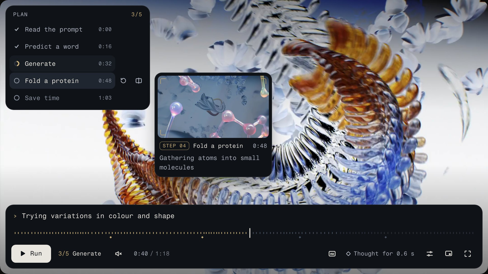

# Run

**A Video.js 10 skin that plays a film as an AI agent’s run.** The film’s chapters become the plan, its captions become the log, and the player shows its own reasoning. Nothing on it pretends a model is running.

**Live:** [run.gua.studio](https://run.gua.studio) · made for the Video.js Skins Design Challenge, November 2026.



## What it does

- **It opens on a prompt.** The player starts on the run’s ask (`data-rn-prompt`), dimmed film behind it. Press **Run**: the prompt’s words become the first layer of a small network drawn in fine lines. One word for each step lights up in the prompt itself, and a brass thread runs from it through the network to the step it becomes, which lights as the thread arrives. Across to the plan on a wide player, down to the track on a phone. Once, under two seconds; not at all under reduced motion.
- **The chapters are the plan.** Each chapter is a step: waiting, running (a brass ring filling with the step), done (a tick drawn in). Click a step to go there, run it again (it loops, as you would regenerate an answer), or compare its first frame with its last.
- **The captions are the log.** The current caption is written into the bar a word at a time, on the bar’s own ink, so it reads over any frame. When the controls rest, the bar keeps only the line: a pill with the step it belongs to and a thread of the step’s progress. Captions never leave with the controls.
- **The track is made of words.** Every caption word is a mark on the timeline. Point at it and the marks near the pointer rise; drag and they turn brass while a preview shows the frame, the step and the line said there.
- **Its reasoning is real.** The key reads *Thought for 0.4 s*: the last wait, measured (in milliseconds when it was quicker than a tenth of a second). Open it for what the player decided (which source and why, the picture size, what is loaded ahead) and a trace of its waits. It also speaks once, unasked, in the log, marked ◇: what it took and what it opened as the run starts, and later a change of picture or a real wait (at most one line every eight seconds). No model is involved, and the panel says so.
- **Commands.** `⌘K` / `Ctrl+K` or `/` opens a palette: speeds, steps, captions, the plan, picture in picture, a link to this moment. `Space` and `Enter` run and stop from anywhere on the page.
- **A report at the end:** each step’s span as a trace, and the viewer’s own run (time taken, stops, steps run again).
- **On a phone the bar is the player’s lower half.** Under 480 px wide, in the page, the log, the track and the keys hang under the picture as one card with it, so none of the film is covered; filling the screen, the bar goes back over it. A page that holds the player in a box of fixed height keeps the bar over the film.
- **Any film.** Without chapters there is no plan (no card, no key), and the log says the run’s state: ready, running, stopped at a time.

## Use it

Run is HTML and CSS around Video.js 10 (`src/video/skin.html`, `src/video/skin.ts`, `src/video/run/`). Give the video its chapters and captions, and the player its prompt:

```html
<video-player data-rn-prompt="Walk through the new dashboard">
  <!-- the markup of src/video/skin.html, with this video in its media slot -->
  <video playsinline crossorigin="anonymous">
    <track kind="chapters" src="steps.vtt" default>
    <track kind="captions" src="log.vtt" srclang="en">
  </video>
</video-player>

<style>
  video-player { --rn-signal: #c9ae78; } /* your brand's signal colour */
</style>
```

`apps/preview/src/run/mount.ts` mounts it in one call (`mount(host, film)`), with the sources tried in order: Mux’s stream where the browser plays HLS itself (Safari, Chrome and Edge 142+), Mux’s MP4 elsewhere (Firefox), and a copy on the site last. No HLS library is loaded.

## Develop

```bash
pnpm install
pnpm dev            # http://127.0.0.1:4480/run.html (the skin alone) and the Video.js workbench at /
pnpm site:dev       # the showcase site, http://127.0.0.1:4484
pnpm film:fallback  # the site's own copy of the film, a last fallback (needs ffmpeg)
pnpm test:e2e       # Chromium, WebKit and Firefox
```

Node 22 or later. `pnpm site:stills` retakes the site’s pictures from the real player; `pnpm measure` writes the numbers the site prints.

## Tested, and not

- **Tested:** the browser battery runs in Chromium, WebKit and Firefox: play and pause by click, Space and Enter; seek by the track and the arrow keys; time; mute and volume; fullscreen; captions; a phone’s layout (the bar under the picture, no sideways scroll at 360 and 390 px); axe (WCAG 2.1 A and AA) at the start and while running.
- **Proofs** (`pnpm test:proofs`, numbers in `test-results/proofs/measure/`): contrast of every text run, icon and mark measured on the pixels behind it over the film’s brightest and darkest frames (4.9:1 for text, 3.4:1 for marks, the track ahead included); every touch target 44 × 44 px or more on a phone, measured where the finger lands; a Tab walk with a real keyboard where every stop has a ring that holds 3:1 (WCAG 2.4.13’s area), in the order on screen, Escape closing the plan, the palette and Reasoning; under reduced motion every still state photographed twice 800 ms apart and identical, the network never drawn. Each guard was seen failing on a planted fault first.
- **By hand:** the iOS Simulator’s Safari, and a real iPhone.
- **Not covered by tests:** the drawings (the network, the halo while dragging) are checked by eye; Android devices; screen readers beyond axe’s rules.

## Credits

Film: *Visualising AI* by Google DeepMind (Wes Cockx, Zünc Studio, Twistedpoly, Martina Stiftinger), via Pexels; streamed from Mux. Its chapters and captions were written for this skin. Nothing here implies endorsement by Google DeepMind.

Made by [Gua](https://gua.studio). Licensed under Apache 2.0 (`LICENSE`, `NOTICE`).
